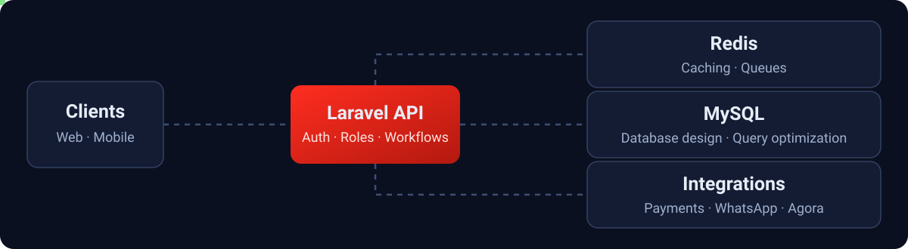

  

  
  
  
  

  <a href="#-about-me"><b>About</b></a> &nbsp;•&nbsp;
  <a href="#-experience"><b>Experience</b></a> &nbsp;•&nbsp;
  <a href="#-projects"><b>Projects</b></a> &nbsp;•&nbsp;
  <a href="https://portfolio-haweil1.vercel.app/"><b>Portfolio</b></a> &nbsp;•&nbsp;
  <a href="#-tech-stack"><b>Tech Stack</b></a> &nbsp;•&nbsp;
  <a href="#-achievements"><b>Achievements</b></a> &nbsp;•&nbsp;
  <a href="#-github-activity"><b>Activity</b></a>

## 💫 About Me

Back-End Developer specializing in **PHP/Laravel**, **RESTful APIs**, scalable backend systems, and third-party integrations. I build and maintain production applications across **Saudi Arabia and the UAE**, including ERP, consulting, healthcare, and booking platforms.

- 🏗️ **Focus:** backend architecture, MySQL, authentication and authorization, performance optimization
- 🚀 **Delivery:** CI/CD, Docker, and production deployments
- 🎓 **Education:** B.S. in Computer Science, Mansoura University
- 🧑‍🏫 **Community:** former Head of the Back-End Circle at Mega Team MU, mentoring members on Laravel, database design, and clean code
- 🌍 **Languages:** Arabic (Native) · English (Professional Working Proficiency)
- ⚽ **Fun fact:** I am a footballer

  

## 💼 Experience

### Back-End Developer — [BOD](https://www.linkedin.com/company/%D8%B4%D8%B1%D9%83%D8%A9-%D9%88%D9%84%D8%A7%D8%AF%D8%A9-%D8%AD%D9%84%D9%85-%D9%84%D9%84%D8%A5%D8%B3%D8%AA%D8%B4%D8%A7%D8%B1%D8%A7%D8%AA-%D9%88%D8%A7%D9%84%D8%A3%D8%A8%D8%AD%D8%A7%D8%AB/home/)
`Mar 2025 – Present` · Remote, Saudi Arabia

- Launched **[Athar-Riyada](https://athar-riyada.com/)**, a consulting platform now live and serving **1,000+ nonprofit organizations**
- Contributing to the development of **[Ibaaq](https://front.ibaaq.com/)**, a multi-role ERP platform for nonprofit organizations
- Contributing to **Athar OS**, an AI-powered platform for managing nonprofit organizations, integrating AI for form analysis and form filling
- Build role-based systems and dashboards with Laravel and Filament, supporting multiple user roles and organizational workflows
- Own CI/CD, deployment, and production workflows, automating build, testing, and deployment for reliable releases
- Collaborate on backend architecture, security, performance optimization, and maintainability

### Freelance Back-End Developer
`May 2025 – Present` · Remote

- Deliver production applications end-to-end for clients across Saudi Arabia and the UAE, from requirements and architecture to deployment and maintenance
- Own the full backend lifecycle: API development, database design, third-party integrations, CI/CD, and production support
- Refactor legacy backend codebases to improve performance, maintainability, and reliability

## 🚀 Projects

My production work across consulting, ERP, healthcare, booking, and sports platforms lives in my portfolio, with the details behind each project.

  

## 🛠 Tech Stack

  
  
  
  
  
  
  
  
  
  
  

| Area | Skills |
| --- | --- |
| **Backend** | PHP · Laravel · REST APIs · NestJS · Livewire · Filament |
| **Architecture** | OOP · SOLID · Design Patterns · MVC · Database Design |
| **Databases** | MySQL · MongoDB · Redis · Firebase |
| **Performance** | Redis Caching · Laravel Queues · Query Optimization |
| **Integrations** | Moyasar · Tabby · Tamara · MyFatoorah · PayPal · WhatsApp Cloud API · Third-Party APIs |
| **Real-Time** | WebSockets · Agora (Video/Voice) · Real-Time Chat |
| **DevOps** | Docker · CI/CD · VPS Management · cPanel · AWS S3 · Git/GitHub |
| **Languages & Tools** | PHP · JavaScript · C++ · Postman |

## 🏆 Achievements

- 🥉 [**IEEE Victories 3.0 Competition**](https://drive.google.com/file/d/1IRWGHKD1PZPNAcN_nJZcAhuykCdbw2rv/view) — 3rd Place
- 🥉 [**GDG Delta Hackathon**](https://drive.google.com/file/d/18KajWaFkVwyYfcmYSj3spUQ-0VGQ4E3D/view) — 3rd Place
- 🛰️ [**NASA Space Apps Hackathon**](https://drive.google.com/file/d/1sL-MP1gqpmURvGQCUUybub-FOZtx28Dw/view)
- 💻 [**ECPC 2024**](https://drive.google.com/file/d/1VMQ3_OongKF42vZY80Li1Oj0rnI4IWW7/view) — Participation
- 📜 [**Data Structures Decode**](https://drive.google.com/file/d/1Z3j4aezLle7jTA30jzC_h3v83ual0JDA/view) · [**Algorithms Analysis & Design**](https://drive.google.com/file/d/15WSFjVahAHO21FkLaMaUALgufhstb3B_/view)

## 📈 GitHub Activity

  

  <picture>
    <source media="(prefers-color-scheme: dark)" srcset="https://raw.githubusercontent.com/haweil/haweil/output/snake-dark.svg" />
    
  </picture>

  
  

  

